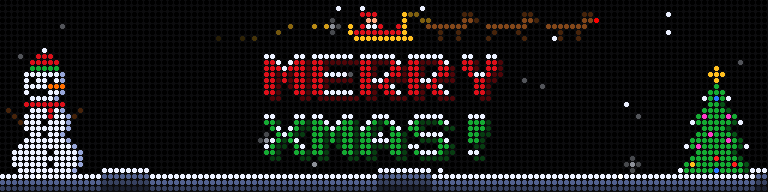

# Festive Countdown

An animated Christmas countdown plugin for [LEDMatrix](https://github.com/ChuckBuilds/LEDMatrix).
Snow falls over a snowman and a twinkling tree, Santa's sleigh flies past
with Rudolph leading the way, and the days left sit in the middle with snow
on top of the digits.


On Christmas Day it shows **MERRY XMAS!**, and from the 26th it starts counting
to next year's Christmas.



Designed for **128x32** (two 64x32 panels chained). On narrower displays the
snowman and tree are left out so the number still fits.

## Install

1. Open the LEDMatrix web interface (`http://<your-pi>:5000`).
2. Go to **Plugin Manager**, find **Install from GitHub → Install Single Plugin**.
3. Paste this repository's URL and click **Install**, then confirm the
   unverified-plugin warning.
4. Enable **Festive Countdown** in the Installed Plugins list and restart the
   display.

## Settings

All of these are in the plugin's tab in the web interface.

| Setting | Default | What it does |
|---|---|---|
| `display_duration` | 20 | Seconds on screen each rotation |
| `number_color` | red | Colour of the big number |
| `label_color` | gold | Colour of DAYS TO GO |
| `show_sleigh` | on | Santa's sleigh flies across the sky |
| `sleigh_every_seconds` | 30 | How often the sleigh flies past |
| `snowflakes` | 34 | How many flakes are falling (0 = no snow) |
| `show_snowman` / `show_tree` | on | Show the snowman / tree |
| `animation_fps` (advanced) | 30 | Frames per second; lower it if the Pi struggles |

The date follows the timezone set in LEDMatrix's General settings.

## Changing the artwork

The snowman, tree, sleigh and reindeer are drawn as text in
[`festive_scene.py`](festive_scene.py): every letter is one LED and the
`PALETTE` at the top of the file says which colour each letter is (a space is
see-through). Edit the letters to redraw a character.

To see your change without the Pi, run the preview from your LEDMatrix folder
(it borrows LEDMatrix's fonts) and open `preview/animation.gif`:

```bash
pip3 install pillow
cd ~/path/to/LEDMatrix
python3 ~/path/to/ledmatrix-festive-countdown/preview.py           # 24 days to go
python3 ~/path/to/ledmatrix-festive-countdown/preview.py --days 0  # Christmas Day
```

## Files

| File | Purpose |
|---|---|
| `manifest.json` | The plugin's ID card: name, version, which class to load |
| `config_schema.json` | The settings, which the web interface turns into a form |
| `manager.py` | Connects the scene to LEDMatrix: works out the days, draws each frame |
| `festive_scene.py` | Draws the picture |
| `preview.py` | Makes a GIF preview on your computer |

## Releasing a change

Bump `version` in `manifest.json` (e.g. `1.0.0` → `1.1.0`), commit and push.
Then use **Update** on the plugin in the Plugin Manager.
